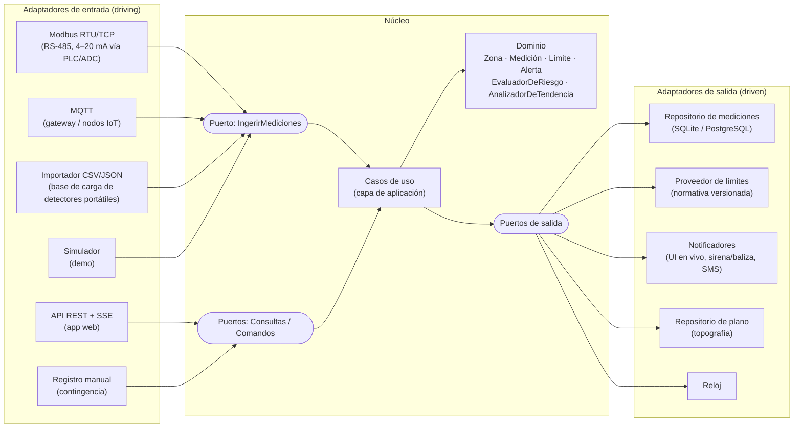
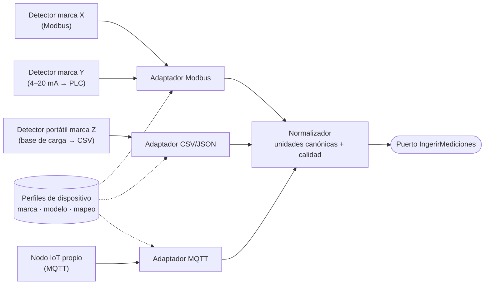
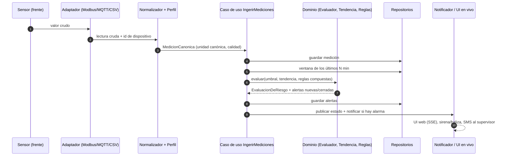
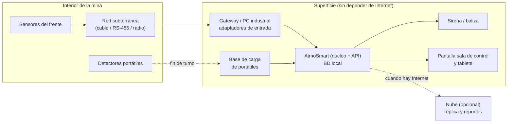

# Arquitectura de AtmoSmart

> Sistema de monitoreo preventivo de atmósferas en minas subterráneas.
> Arquitectura hexagonal (puertos y adaptadores), independiente de la marca y del protocolo de los sensores.
> **Alcance del demo inicial: un frente de explotación.**

---

## 1. Objetivo y principios

AtmoSmart debe recibir mediciones de **cualquier equipo de detección** (fijo o portátil, de cualquier fabricante), evaluarlas frente a los **límites de la normativa vigente** y generar **alertas preventivas** a tiempo. Debe funcionar también **sin Internet**.

| Principio | Qué significa en la práctica |
| --- | --- |
| **El dominio no conoce sensores ni bases de datos** | Las reglas de seguridad (límites, tendencias, alertas, protocolos) viven en el núcleo y no importan librerías de hardware, HTTP ni base de datos. |
| **Agnóstico de marca y protocolo** | Para integrar una marca nueva se agrega un *perfil de dispositivo* (configuración). Solo un **protocolo** nuevo requiere escribir un adaptador. |
| **Nadie digita en la mina** | La entrada principal es automática (sensores → gateway). El registro manual es un adaptador más, reservado para contingencias y siempre marcado como tal. |
| **Primero lo local (*offline-first*)** | Todo corre en un servidor o gateway en superficie dentro de la red de la mina. La nube, si existe, es solo un respaldo o réplica. |
| **Normativa como dato, no como código** | Los límites se cargan versionados (decreto, fecha, responsable). Si cambia la norma, se actualiza la configuración sin reprogramar. |
| **Trazabilidad** | Cada medición conserva su origen, su calidad y la versión del límite con que se evaluó. Cada alerta conserva quién la reconoció y qué se hizo. |

---

## 2. Vista general (hexágono)



**Regla de dependencias:** `adaptadores → aplicación → dominio`. Nunca al revés. El dominio define interfaces (puertos) y los adaptadores las implementan.

---

## 3. Dominio

### 3.1 Entidades y objetos de valor

| Concepto | Descripción | Campos clave |
| --- | --- | --- |
| `Mina` | Unidad minera | id, nombre, tipo de mineral, categoría por grisú |
| `Plano` | Versión del plano de labores y ventilación | versión, fecha, fuente, nodos, tramos, ventiladores |
| `Zona` (labor) | Sector monitoreado | id, nombre, nivel, **tipo** (`frente_ciego`, `galeria_entrada`, `galeria_retorno`, `chimenea`, `servicio`), estado (activa / suspendida / sellada) |
| `PuntoDeMedicion` | Lugar físico dentro de la zona donde se instala un equipo | zona, descripción (p. ej., "a 5 m del tope") |
| `Dispositivo` | Equipo físico | id, tipo, **perfil** (marca/protocolo), punto de medición, fecha de calibración |
| `Variable` | Magnitud medida | clave (`o2`, `ch4`, `co`, `co2`, `h2s`, `no2`, `temp`, `hr`, `vel_aire`, `ventilador_aux`), **unidad canónica** |
| `Medicion` | Una lectura | variable, valor (en unidad canónica), instante, dispositivo, zona, **origen** (`sensor_fijo`, `portatil`, `manual`, `simulado`), **calidad** |
| `Limite` | Umbrales para una variable | precaución/alarma, mínimos/máximos, **referencia normativa**, versión, vigencia |
| `EvaluacionDeRiesgo` | Resultado de evaluar una zona en un instante | estado (`normal`, `precaucion`, `alarma`, `sin_senal`), variables que lo causan |
| `Alerta` | Evento que requiere acción | tipo, severidad, zona, causa, valor, límite, instante, estado (`activa`, `reconocida`, `resuelta`) |
| `Protocolo` | Pasos de respuesta por tipo de alerta | pasos, responsable, fuente (plan de emergencias de la mina) |
| `Reconocimiento` | Registro de quién atendió la alerta | usuario, rol, instante, acción tomada |
| `Voladura` | Disparo programado | zona, hora, tiempo de reingreso |
| `Turno` | Turno de trabajo | supervisor, horario, personal por zona |

### 3.2 Calidad de la medición

Antes de evaluar el riesgo, cada medición se clasifica. Una lectura dudosa **no se descarta**: se marca y se informa.

| Calidad | Cuándo |
| --- | --- |
| `valida` | Dentro del rango físico del sensor y con calibración vigente |
| `fuera_de_rango` | Valor imposible para la variable (p. ej., O₂ > 100 %) o fuera del rango del equipo |
| `congelada` | El valor no cambia en N minutos (posible sensor bloqueado) |
| `calibracion_vencida` | El dispositivo tiene la calibración o la prueba de respuesta vencida |
| `manual` | Ingresada a mano; exige el detector usado y el motivo |

### 3.3 Servicios de dominio (las reglas que hacen que no sea un CRUD)

1. **`EvaluadorDeUmbrales`**: compara cada medición con el `Limite` vigente y devuelve `normal`, `precaucion` o `alarma`.
2. **`AnalizadorDeTendencia`**: aplica una regresión lineal sobre una ventana móvil (configurable, p. ej. 15 min) y estima **los minutos que faltan para llegar a la alarma**. Genera una alerta **predictiva** si ese tiempo es menor al horizonte configurado.
3. **`DetectorDeSilencio`** (*heartbeat*): si un dispositivo no reporta en X segundos, la zona pasa a `sin_senal`. **Una zona sin datos nunca se muestra como "normal".**
4. **`ReglasCompuestas`**: combinan variables y contexto de la operación. Ejemplos:
   - Ventilador auxiliar **apagado** + personal en el frente → alarma, aunque los gases aún estén bajos.
   - CH₄ en ascenso + velocidad del aire en descenso → se eleva la severidad (falla de ventilación probable).
   - CO o NO₂ altos **dentro del tiempo de reingreso de una voladura registrada** → se clasifica como "gases de voladura: no reingresar" y no como falla de equipo.
5. **`GestorDeAlertas`**: crea, deduplica (no repite la misma alerta cada segundo), escala si nadie la reconoce en N minutos y cierra la alerta cuando la condición se normaliza durante un tiempo mínimo (histéresis).

> Los valores concretos (límites, ventanas, tiempos de escalamiento y de reingreso) son **configuración** y deben validarse con Ingeniería de Minas según el **Decreto 1886 de 2015** y el plan de emergencias de la mina.

---

## 4. Puertos

### 4.1 Puertos de entrada (lo que el mundo le pide al sistema)

```ts
// La ingesta recibe lecturas ya normalizadas por el adaptador
interface IngerirMediciones {
  ejecutar(lote: MedicionCanonica[]): Promise<ResultadoIngesta>;
}

interface ConsultarEstado {
  estadoMina(): Promise<EstadoZona[]>;
  estadoZona(zonaId: string): Promise<EstadoZonaDetalle>;
  serie(zonaId: string, variable: string, desde: Date, hasta: Date): Promise<Punto[]>;
}

interface GestionarAlertas {
  listar(filtro: FiltroAlertas): Promise<Alerta[]>;
  reconocer(alertaId: string, usuario: Usuario, accion: string): Promise<void>;
}

interface RegistrarLecturaManual {        // solo contingencia
  ejecutar(cmd: { zonaId: string; valores: Record<string, number>; detector: string; motivo: string; usuario: Usuario }): Promise<void>;
}

interface GestionarPlano      { publicarVersion(plano: Plano): Promise<void>; vigente(): Promise<Plano>; }
interface GestionarLimites    { publicar(limites: Limite[], referencia: string, usuario: Usuario): Promise<void>; }
interface RegistrarVoladura   { ejecutar(v: Voladura): Promise<void>; }
```

### 4.2 Puertos de salida (lo que el sistema necesita del mundo)

```ts
interface RepositorioMediciones { guardar(m: Medicion[]): Promise<void>; ventana(zonaId: string, variable: string, minutos: number): Promise<Medicion[]>; }
interface RepositorioAlertas    { guardar(a: Alerta): Promise<void>; activas(zonaId?: string): Promise<Alerta[]>; }
interface RepositorioPlano      { vigente(): Promise<Plano>; guardar(p: Plano): Promise<void>; }
interface ProveedorDeLimites    { vigentes(variable: string, tipoZona: TipoZona): Promise<Limite>; }
interface CatalogoDispositivos  { porId(id: string): Promise<Dispositivo>; perfil(perfilId: string): Promise<PerfilDispositivo>; }
interface Notificador           { notificar(alerta: Alerta, destinatarios: Rol[]): Promise<void>; }
interface PublicadorEnVivo      { publicar(evento: EventoDominio): void; }   // SSE / WebSocket hacia la UI
interface Reloj                 { ahora(): Date; }                            // permite simular tiempo en pruebas y demo
```

---

## 5. Independencia de marca: perfiles de dispositivo

El problema: cada fabricante (por ejemplo MSA, Dräger, Industrial Scientific o Honeywell, entre otros) y cada modelo entrega los datos de forma distinta: registros Modbus, señal analógica de 4–20 mA, exportación desde la base de carga, Bluetooth, etc.

La solución tiene **dos niveles**:

1. **Adaptador por protocolo** (código): uno para Modbus, uno para MQTT, uno para el importador CSV/JSON y así. Cada uno sabe *cómo leer*, pero no *qué significa* cada dato.
2. **Perfil de dispositivo por marca/modelo** (configuración JSON/YAML): dice *qué significa* cada dato: qué registro o campo corresponde a cada variable, su escala, su unidad y su rango.



**Integrar una marca nueva = escribir su perfil.** No se toca el dominio ni los casos de uso.

### Ejemplo de perfil (genérico, ilustrativo)

```yaml
# perfiles/multigas-modbus-generico.yaml
id: multigas-modbus-generico
fabricante: "<completar según ficha técnica>"
modelo: "<completar>"
protocolo: modbus-rtu
conexion: { baudios: 9600, paridad: none, id_esclavo: 1 }
intervalo_lectura_s: 5
canales:
  - variable: ch4
    registro: 30001        # dirección según el manual del fabricante
    escala: 0.01           # valor_crudo * escala
    unidad_origen: "%LEL"  # el normalizador convierte a % vol
  - variable: co
    registro: 30002
    escala: 1
    unidad_origen: ppm
  - variable: o2
    registro: 30003
    escala: 0.1
    unidad_origen: "%vol"
estado:
  registro_falla: 30010    # bits de falla del equipo → calidad = fuera_de_rango
```

> ⚠️ Los registros, escalas y unidades **deben salir del manual o ficha técnica del equipo real**. No se deben suponer. Si la mina solo tiene detectores portátiles, el adaptador inicial es el **importador de la base de carga** (CSV/JSON exportado por el software del fabricante).

### Mensaje canónico (lo que todo adaptador entrega al núcleo)

```json
{
  "dispositivoId": "MG-FREN-01",
  "zonaId": "frente-2",
  "instante": "2026-10-29T13:45:05-05:00",
  "origen": "sensor_fijo",
  "lecturas": [
    { "variable": "ch4", "valor": 0.83, "unidad": "%vol" },
    { "variable": "co",  "valor": 7,    "unidad": "ppm" },
    { "variable": "o2",  "valor": 20.2, "unidad": "%vol" }
  ]
}
```

**Conversión de unidades:** el metano se reporta a veces en **%LEL** (porcentaje del límite inferior de explosividad) y otras en **% vol**. El normalizador lo lleva siempre a la unidad canónica antes de evaluar. El factor de conversión depende de la calibración del equipo y **debe validarse con Minas y con la ficha del fabricante**.

---

## 6. Flujo de una lectura



En paralelo, el `DetectorDeSilencio` revisa periódicamente qué dispositivos dejaron de reportar.

---

## 7. Demo inicial: frente de explotación

### 7.1 Por qué el frente

Es la labor de **mayor riesgo atmosférico**: es una **labor ciega** (el aire entra y sale por el mismo acceso), depende de un **ventilador auxiliar con manga**, allí se libera el gas del macizo al avanzar y allí ocurren las voladuras. Si el sistema funciona en el frente, el modelo se extiende al resto de la mina.

### 7.2 Instrumentación del frente (mínima para el demo)

| Punto | Equipo (tipo genérico) | Variables |
| --- | --- | --- |
| Cerca del tope del frente | Detector multigas fijo | CH₄, CO, O₂ (opcional CO₂, H₂S, NO₂ según el mineral) |
| Frente | Sensor de temperatura / humedad | T, HR |
| Salida de la manga | Anemómetro o sensor de flujo | Velocidad del aire |
| Ventilador auxiliar | Contacto de marcha o sensor de corriente | Ventilador encendido / apagado |
| Trabajador | Detector portátil personal | CH₄, CO, O₂, H₂S (se descarga al final del turno) |
| Acceso al frente | Control de lámparas o fichas | Personas dentro del frente |

### 7.3 Guion del demo (5 escenas, usando el adaptador **Simulador**)

| # | Escena | Qué demuestra |
| --- | --- | --- |
| 1 | Operación normal: todo en verde, el mapa muestra el frente con su ventilador auxiliar y la manga. | Monitoreo en tiempo real sin digitar nada. |
| 2 | El CH₄ empieza a subir de forma sostenida. Antes de llegar al límite aparece: *"Metano en ascenso: alcanzaría la alarma en ~12 min"*. | **Alerta predictiva** (no es un simple "si valor > límite"). |
| 3 | El ventilador auxiliar se apaga. Aunque los gases aún no están en alarma, el sistema la dispara porque hay personas en el frente. | **Regla compuesta** con contexto de la operación. |
| 4 | El supervisor abre la alerta, sigue el protocolo y la reconoce con la acción tomada. La condición se normaliza y la alerta se cierra. | **Respuesta guiada y trazabilidad**. |
| 5 | El detector fijo deja de reportar: la zona pasa a "sin señal" (no a "normal"). Se registra una lectura del detector portátil como contingencia. | **Tolerancia a fallas** y registro manual controlado. |

### 7.4 Del simulador a la mina real

El **simulador es un adaptador de entrada más**: implementa el mismo puerto `IngerirMediciones` que usará el adaptador Modbus o CSV. Pasar del demo a una instalación real es **cambiar de adaptador**, no reescribir el sistema.

---

## 8. Despliegue



- **Demo / hackatón:** el frontend actual (`frontend/`) con `mock-api.js`, que hace las veces de adaptador simulador más un repositorio en `localStorage`.
- **Piloto:** un servidor local en superficie con base de datos SQLite o PostgreSQL y la UI servida en la red de la mina.

---

## 9. Estructura de carpetas propuesta (backend)

TypeScript / Node.js, el mismo lenguaje del frontend, para que todo el equipo de sistemas pueda trabajar en ambas partes.

```
backend/
├── src/
│   ├── domain/                    # sin dependencias externas
│   │   ├── model/                 # Zona, Medicion, Limite, Alerta, Plano...
│   │   ├── services/              # EvaluadorDeUmbrales, AnalizadorDeTendencia,
│   │   │                          # DetectorDeSilencio, ReglasCompuestas, GestorDeAlertas
│   │   └── events/                # MedicionRegistrada, AlertaCreada, AlertaReconocida...
│   ├── application/
│   │   ├── ports/
│   │   │   ├── in/                # IngerirMediciones, ConsultarEstado, GestionarAlertas...
│   │   │   └── out/               # RepositorioMediciones, Notificador, ProveedorDeLimites...
│   │   └── use-cases/             # implementación de los puertos de entrada
│   ├── adapters/
│   │   ├── in/
│   │   │   ├── http/              # API REST + SSE para el frontend
│   │   │   ├── simulator/         # escenarios del demo (frente de explotación)
│   │   │   ├── modbus/
│   │   │   ├── mqtt/
│   │   │   ├── file-import/       # CSV/JSON de bases de carga
│   │   │   └── normalizer/        # perfiles + unidades canónicas + calidad
│   │   └── out/
│   │       ├── persistence/       # sqlite/, postgres/, memory/ (pruebas)
│   │       ├── notifications/     # sse/, siren-gpio/, sms/
│   │       └── regulations/       # carga de límites versionados
│   └── main.ts                    # composición: elige qué adaptadores conectar
├── config/
│   ├── limites/decreto-1886-2015.yaml   # a completar y validar por Minas
│   ├── perfiles/                        # un archivo por marca/modelo
│   └── planos/                          # versiones del plano
└── test/                                # el dominio se prueba sin hardware
```

`main.ts` es el único lugar que sabe qué adaptadores están conectados. Por ejemplo: `simulator + memory + sse` para el demo, o `modbus + sqlite + sse + siren` para el piloto.

---

## 10. API para el frontend

El frontend ya consume estas operaciones a través de `frontend/assets/js/mock-api.js`. Al tener backend, cada función se reemplaza por un `fetch` al endpoint correspondiente.

| Método | Ruta | Uso |
| --- | --- | --- |
| GET | `/api/mina/plano` | Plano vigente (dibuja el mapa) |
| GET | `/api/zonas/estado` | Estado actual de todas las zonas |
| GET | `/api/zonas/:id/estado` | Detalle de una zona |
| GET | `/api/mediciones?zona=&variable=&desde=&hasta=&paso=` | Series para gráficos e historial |
| GET | `/api/alertas` | Alertas activas, reconocidas y resueltas |
| POST | `/api/alertas/:id/reconocer` | Reconocimiento con la acción tomada |
| POST | `/api/mediciones/manual` | Registro de contingencia |
| GET | `/api/dispositivos` | Estado, batería y calibración |
| GET / PUT | `/api/limites` | Límites versionados |
| POST | `/api/voladuras` | Registro de voladura (contexto para las reglas) |
| GET | `/api/stream` | Eventos en vivo (SSE): mediciones y alertas |

---

## 11. Pendientes a validar con el equipo

| Tema | Responsable |
| --- | --- |
| Límites por variable y acciones obligatorias según el Decreto 1886 de 2015 | Ingeniería de Minas |
| Tipo de mina de referencia (carbón / oro) y gases a priorizar | Ingeniería de Minas |
| Equipos que existen realmente en la mina de referencia y cómo exportan datos | Minas + Sistemas |
| Ventanas de tendencia, tiempos de escalamiento y de reingreso tras voladura | Minas + Industrial |
| Flujo de respuesta: quién recibe qué alerta y en cuánto tiempo | Ingeniería Industrial |
| Tecnología del backend y base de datos del piloto | Sistemas |

Ver también: [`requerimientos-de-datos.md`](requerimientos-de-datos.md).

---

## Glosario

- **Labor ciega / frente ciego:** labor con un solo acceso; se ventila con un ventilador auxiliar y una manga.
- **Manga:** ducto flexible que lleva el aire del ventilador auxiliar hasta el tope del frente.
- **Retorno:** vía por donde sale el aire viciado hacia el ventilador principal.
- **%LEL:** porcentaje del límite inferior de explosividad de un gas.
- **Prueba de respuesta (*bump test*):** exposición breve del detector a un gas conocido para comprobar que responde.
- **Puerto:** interfaz definida por el núcleo. **Adaptador:** implementación concreta de un puerto para una tecnología.
